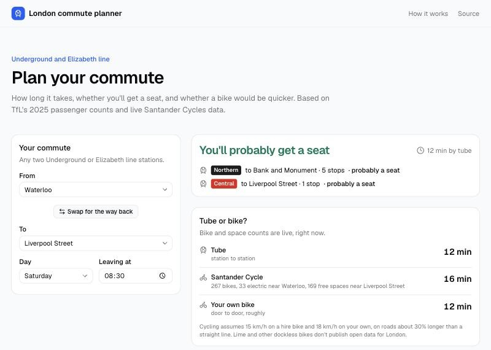

# London commute planner

[](https://github.com/patrickridge/london-commute/actions/workflows/ci.yml)

Live site: https://london-commute-planner.vercel.app

Pick two stations (or postcodes) and a time. The planner shows how long the journey takes, whether you'll get a seat on each part of it, and whether another way would be better: getting off early and walking, staying on one line instead of changing, or doing part of the trip by Santander Cycle.



## Why

When I moved to London I wanted to know three things about my commute: how long it would take, whether I'd get a seat, and whether cycling would be better. Journey planners answer the first. TfL publishes the data for the other two, but not in a form anyone reads before leaving the house.

## How it works

**How full your train is.** TfL's NUMBAT dataset (2025) estimates, for a typical day, how many people travel on every stretch of the Underground and Elizabeth line in each 15-minute band, and how many trains run. Dividing one by the other gives the average number of people on each train, which is compared with its seats and total capacity (from TfL's rolling stock information sheets):

| People per train | Answer |
|---|---|
| under 80% of seats | probably a seat |
| 80–110% of seats | might get a seat |
| over 110% of seats | you'll stand |
| over 90% of capacity | very crowded |

The cut-offs are my own judgement: the figures are averages over the whole train, and the ends of a train are usually emptier than the middle.

Capacity is TfL's crush figure: everyone standing, packed tight. In practice people stop moving down long before that, so a train can be too full by the doors to get on while the average is only just over half of it. From 55% of capacity the planner warns that some trains may be too full to board, and the chart marks that level with a dashed line instead of the crush figure, which typical trains never get near.

**Your route.** Each line is a set of one-way links between stations, joined where stations share a name. Dijkstra's algorithm finds the route with the fewest stops, with a change of line costing four stops, and leaves out lines with no trains around your time. Half-hourly lines leave empty 15-minute bands, so a band with no train uses the next one.

**From your door.** Either end can be a postcode instead of a station. It's looked up with [postcodes.io](https://postcodes.io) (free, no key; only the postcode is sent), the nearest stations are offered with walking times, and every option is timed door to door.

**For a regular commute.** The journey card shows TfL's live status for the lines on your route (with TfL's reason when there are delays), and a strip of the same trip leaving up to 45 minutes earlier or later, so you can see when you'd get a seat or avoid trains too full to board. The page remembers your last journey on that device and opens straight to it.

**Journey time.** From TfL's Journey Planner, station to station. If it's unavailable, the page falls back to a rough estimate (2 minutes a stop, 5 a change).

**Other ways to do it** (`lib/options.ts`). The planner also tries:

- getting off at any station within a 20-minute walk of the destination and walking the rest, which covers both getting off early and staying on one line instead of changing;
- the tube part way, then a Santander Cycle from a dock near that station;
- a Santander Cycle to another station, then the tube;
- a hire bike, your own bike, or walking, all the way.

To make that quick, it runs Dijkstra's algorithm once from the start (and once backwards from the destination) rather than once per station. Tube times are estimated from stops, changes and platform waits, scaled so the main route matches TfL's Journey Planner. Each option gets the same seat check as the main route. It shows at most four, and only ones that are quicker, calmer, or save a change compared with the tube all the way. TfL's BikePoint API gives live counts of bikes and free spaces at all ~800 docks; riding assumes 15 km/h on a hire bike and 18 km/h on your own, walking 4.8 km/h, on roads about 30% longer than a straight line.

## Where the data comes from

The network data in `public/data/` is built by a Python pipeline in [tube-crowding](https://github.com/patrickridge/tube-crowding), which also has the data-quality notes and an earlier Streamlit version. The route planner and seat levels here are a TypeScript port of that code, and `lib/seats.test.ts` checks that both versions give the same answer for 300 random journeys.

Journey answers are worked out in the browser from one day's data file (about 90 KB). Only the live parts go through the server, in `app/api/live/route.ts`, so the TfL key stays private.

## Limitations

- Typical days only: no strikes, delays or events.
- Averages over the whole train. Some carriages will be fuller than others.
- Underground and Elizabeth line only. Metropolitan line fast trains aren't included.
- Bike and space counts are live, so they only tell you about right now.
- Santander Cycles cover central and inner London; many outer stations have no dock nearby. Lime and other dockless bikes don't publish open data for London.

## Running it locally

Needs Node 24.

```bash
npm install
cp .env.example .env.local   # optional: add a free key from api-portal.tfl.gov.uk
npm run dev
```

Then open http://localhost:3000.

## Checks

```bash
npm test
npm run lint
npm run typecheck
npm run build
```

GitHub Actions runs all four on every push.

## Code layout

```
lib/seats.ts              Route planning and seat levels (no UI)
lib/bikes.ts              Nearby docks and bike times (no UI)
lib/options.ts            Other ways to do the trip: walk, stay on, bike part way (no UI)
lib/places.ts             Postcode lookup and nearest stations
lib/lines.ts              TfL line IDs and live status responses
lib/tfl.ts                Server-side calls to TfL, cached
app/api/live/route.ts     TfL's journey time between two stations
app/api/docks/route.ts    Live Santander Cycles docks
app/api/status/route.ts   Live status of the lines on a journey
components/Planner.tsx    The planner
components/Options.tsx    Other ways to do it
components/PostcodeField.tsx  Starting or ending at a postcode
components/TrainChart.tsx How full the first train is through the day
public/data/              Stations and per-day train loads, exported from tube-crowding
```

Built with Next.js, TypeScript, Tailwind CSS, shadcn/ui and Recharts.

## What I'd do next

1. Predict bikes and spaces at a dock for a chosen time, from logged dock history.
2. The Overground and DLR, which are in the same TfL dataset.
3. Live line status next to the journey, so disruption shows up.

## Data and licence

Powered by TfL Open Data. Contains OS data © Crown copyright and database rights 2016 and Geomni UK Map data © and database rights [2019]. Used under TfL's [transport data terms](https://tfl.gov.uk/corporate/terms-and-conditions/transport-data-service). Train capacities from TfL's rolling stock information sheets. Not affiliated with TfL.

The code is MIT licensed (see [LICENSE](LICENSE)).
